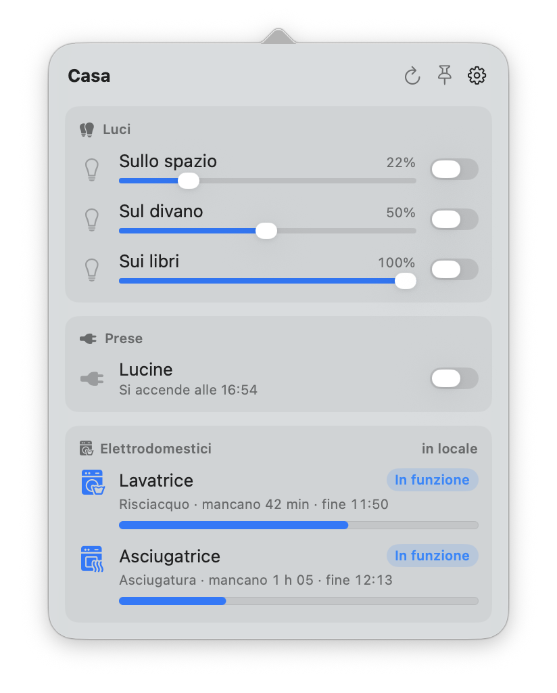

# Domotica

A macOS menu bar app for the smart devices in your home: Shelly lights, TP-Link
Kasa plugs, and Samsung washers and dryers. It talks to them directly on your
network, with no cloud account.



The interface is in Italian.

- Click the house in the menu bar for the panel. Drag the panel away, or press
  the pin, and it becomes a floating window: it stays above other windows, on
  every Space, and doesn't take the focus from the app you're using. The pin in
  the floating window docks it back.
- While a washer or dryer runs, the menu bar icon becomes that appliance and
  counts down the time left; when the cycle ends, a notification tells you.
- Devices are found by themselves. Settings has the SmartThings fallback, the
  light channels to hide, and opening at login.

## Supported devices

| Device | How the app talks to it | What you get |
| --- | --- | --- |
| Shelly Gen2 and later with Light components (dimmers, Plus RGBW PM in the "light" profile) | RPC over HTTP; found with Bonjour (`_shelly._tcp`) | On/off and brightness for each channel, power drawn. Channels named like "Disconnessa" or "unused" start hidden. |
| TP-Link Kasa plugs on the legacy local protocol (HS100, HS103, HS105, HS110…) | XOR-scrambled JSON over TCP 9999; found by UDP broadcast | On/off, time on, next scheduled change |
| Samsung washers and dryers with Wi-Fi, about 2022 onward | OCF over CoAP-DTLS on the LAN, read only; SmartThings as a fallback | State, phase, time left, end time, progress |

Not supported: Shelly Gen1 devices, Shelly switches, covers and the RGB/RGBW
profiles, password-protected Shelly devices; Kasa devices on the newer KLAP
firmware, Kasa bulbs and power strips; starting or pausing appliances.

## Requirements

- macOS 14 or later. Built and tested with Xcode 26 on macOS 26.
- The devices on the same network as the Mac (an IPv4 subnet up to /22).
- An Apple Development certificate, recommended: see [Signing](#signing).

## Build and run

```sh
git clone https://github.com/balsick/home-control-mac.git
cd home-control-mac
./run.sh
```

`run.sh` builds the app, installs it as `/Applications/Domotica.app` and starts
it. It also takes:

```sh
./run.sh --no-tail  # don't follow the log afterwards
./run.sh probe      # print what the app finds on the network and in SmartThings
./run.sh stop
```

On the first launch macOS asks to let Domotica "find devices on local
networks": allow it, or no device answers. It asks about notifications the
first time a washer or dryer shows up.

The app has to start from /Applications through LaunchServices (`open`, as
`run.sh` does), not as a bare binary: macOS asks the local network permission
for the app that started a process.

The log is `~/Library/Logs/Domotica.log`.

### Signing

`run.sh` signs with the first Apple Development identity in the keychain, or the
one named by `HOMECONTROL_SIGN_IDENTITY`, otherwise ad hoc. macOS ties the local
network permission and the keychain items to the signature, and an ad-hoc one
changes on every build: with it, each rebuild asks for the permission again and
can't read the saved credentials.

## Samsung appliances on the LAN

Samsung washers and dryers are OCF devices. They open no TCP port, but answer
CoAP on UDP 5683: `/oic/d` (type and model) to anyone, everything else over
DTLS on a port they advertise. The app finds them by asking every host of the
subnet for `/oic/d`, then keeps one DTLS session per appliance (they take one
local connection at a time), with Observe on `/operational/state/0` and a read
every 30 seconds while running, 60 otherwise.

Getting in relies on a weakness found and published by
[LocalThings](https://github.com/mbillow/localthings) and
[SmartThings-Local](https://github.com/QuiteYellow/SmartThings-Local): the
appliances' factory access list gives every right to the SmartThings cloud
service, identified by a UUID in the client certificate's subject, and their
TizenRT stack doesn't check who signed the certificate. So the app makes a
self-signed P-256 certificate carrying that UUID and keeps it, with its key, in
the login keychain. The app only reads. A firmware update could close the gap;
then the app falls back to SmartThings by itself.

Only one local client at a time: don't run Domotica next to LocalThings or
another local integration for the same appliances.

Tested on a WW90CGC04DAEET washer and a DV80CGC2B0AEET dryer (board
`DA_WM_TP1_21_COMMON`, TizenRT 3.1). LocalThings reports that some newer models, such as
the WD53DBA900HZ washer-dryer, need another kind of authentication and don't
work this way yet. Wire details that
matter: DTLS 1.2 with ECDHE-ECDSA-AES128-GCM-SHA256; a client certificate split
over two datagrams is dropped, hence P-256 rather than RSA; confirmable
responses must be acknowledged; every block of a Block2 transfer must reuse the
first block's token. The resources are in the `/device/0` collection
(`?if=oic.if.ll` lists them), not in `/oic/res`.

## SmartThings, optional

The app asks SmartThings only for the appliances the LAN doesn't give: models
without the local interface, a firmware that closed it, or when you're away
from home. Settings › SmartThings has two ways in:

1. **Personal token**, free. Create it at
   <https://account.smartthings.com/tokens> with Devices (list, see, control)
   and Locations (see). SmartThings makes new personal tokens expire after 24
   hours: the panel warns in the last three hours, a notification reminds you
   an hour before and again once it has expired, and "Rinnova…" (or a click on
   the notification) opens SmartThings' token page and the settings to paste
   the new one.
2. **OAuth**, permanent: the app renews the access token by itself. It needs an
   "API Access" app on your SmartThings account, which since 4 November 2026
   only Developer Plan subscribers can create (free accounts get 403). With the
   plan, create it in the [SmartThings Console](https://developer.smartthings.com/console)
   with redirect URI `https://httpbin.org/get` and scopes `r:devices:*`,
   `x:devices:*`, `r:locations:*`, and paste its client ID and secret. Then
   "Autorizza nel browser": sign in, pick the location, allow; the browser ends
   on httpbin.org, which shows the code to paste back. SmartThings swaps the
   refresh token on every renewal; after a long break (community reports say
   30 days) the app may ask to authorize again.

The API counts calls (the Developer Plan allows 100,000 a month). The app reads
a running appliance every minute, an idle one every 5 minutes and the device
list every 6 hours: about 25,000 calls a month for two appliances.

## Privacy

- The app talks to the devices on your network and, only when it's needed and
  set up, to `api.smartthings.com`. Nothing else: no analytics, no updates
  check.
- SmartThings credentials and the appliance certificate live in the login
  keychain (service `dev.balsamo.home-control`); device addresses and settings
  in the app's preferences.
- Away from home the saved addresses belong to someone else's network. The app
  recognises home by its router's MAC address and, elsewhere, doesn't search,
  connect or poll; "Cerca di nuovo" in the panel still does (after changing
  router, for one).
- `./run.sh probe` saves the raw status of each appliance, with no
  credentials, in `~/Library/Application Support/Domotica/probe/`.

## Development

- `Sources/HomeCore`: device protocols, discovery and parsing, with no UI:
  Shelly, Kasa, SmartThings, CBOR, CoAP, the DTLS session (Network.framework)
  and the appliance certificate.
- `Sources/HomeControl`: the app. `Home` holds the state and polls (Shelly and
  Kasa every 3 seconds while the panel is on screen, 20 otherwise);
  `LocalAppliances` keeps the appliance sessions; `AppDelegate` owns the status
  item, the popover, the floating panel and the settings window.
- `Tests/HomeCoreTests`: `swift test` runs the parsing tests, on payloads from
  real devices with their identifiers replaced. The live tests switch a real
  light channel and plug on for two seconds, then put them back:
  `HOMECONTROL_LIVE=1 swift test --filter LiveTests` (`HOMECONTROL_LIVE_CHANNEL`
  picks the Shelly channel, 2 by default).
- `swift Icon/make-icon.swift Icon/AppIcon.icns` redraws the icon.
- The app also takes `--demo` (two running appliances, made up) and
  `--snapshot <png> --target panel|popover|settings|statusitem [--tab n]
  [--appearance dark]`, which opens that window, saves it as a PNG and quits.

## Disclaimer

Not affiliated with or endorsed by Samsung, Shelly or TP-Link; their names and
trademarks belong to them. The Samsung local interface is undocumented and
reached through a firmware weakness: the app only reads from your own
appliances, but use it at your own risk.

## License

MIT, see [LICENSE](LICENSE).
